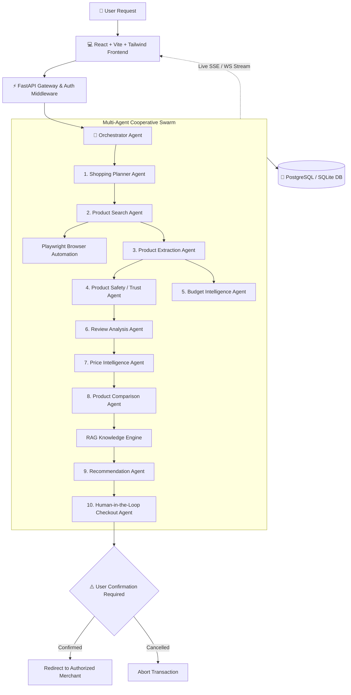

# System Design & Architecture: E-Commerce AI Multi-Agent Shopping Assistant

## Overview
The platform coordinates a cooperative swarm of 10 specialized AI agents to analyze natural-language shopping requests, extract hardware constraints, search authorized vendor catalogs, audit customer reviews, compute price intelligence, and rank recommendations with transparent justifications.

## Multi-Factor Recommendation Algorithm
The Recommendation Agent calculates overall match through an empirical weighted formula:

$$\text{Score} = (0.30 \times \text{Match}) + (0.25 \times \text{Price}) + (0.20 \times \text{Perf}) + (0.15 \times \text{Reviews}) + (0.05 \times \text{Trust}) + (0.05 \times \text{Warranty})$$

- **Requirement Match (30%)**: Verifies RAM, SSD, GPU, and processor specs.
- **Price Justification (25%)**: Scores distance below maximum budget ceiling.
- **Hardware Performance (20%)**: CUDA capability, TGP wattage, NPU TOPS, and core counts.
- **Buyer Reviews (15%)**: Normalized rating and aspect sentiment.
- **Trust & Warranty (10%)**: Authentic seller verification and warranty coverage.
